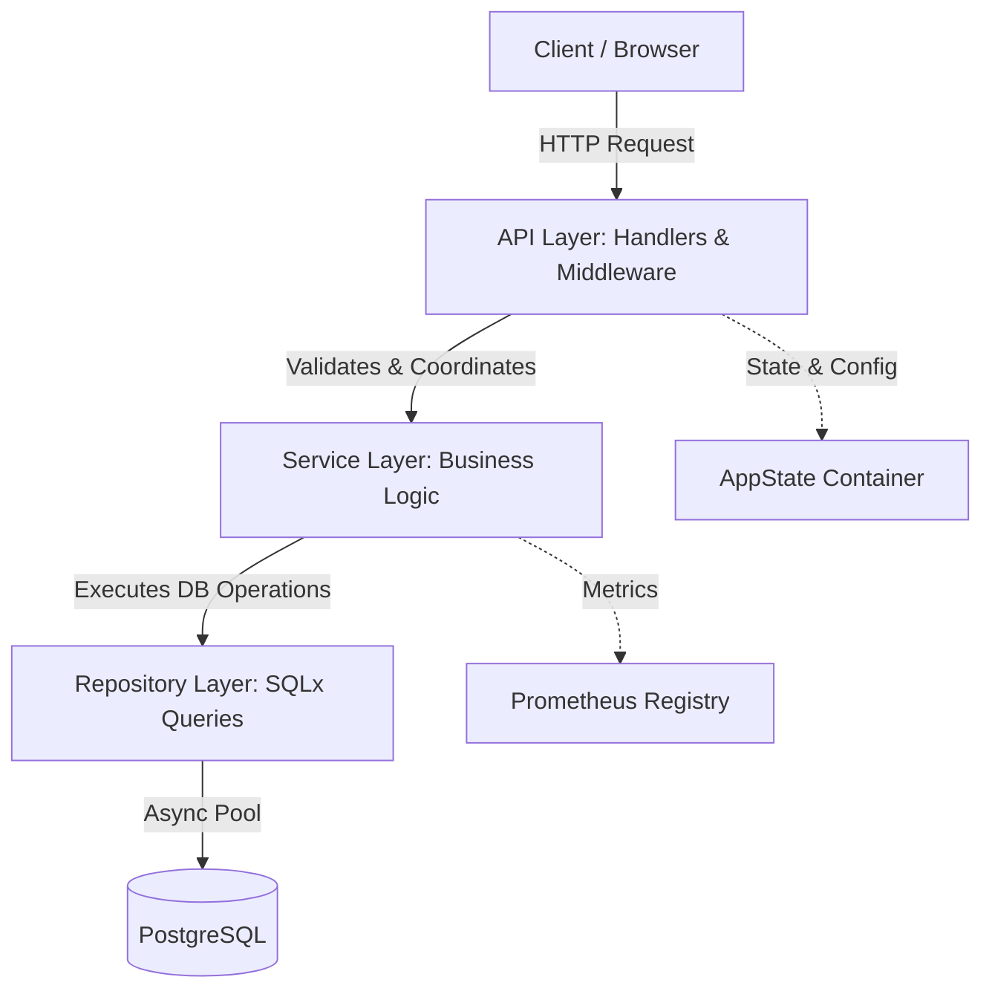
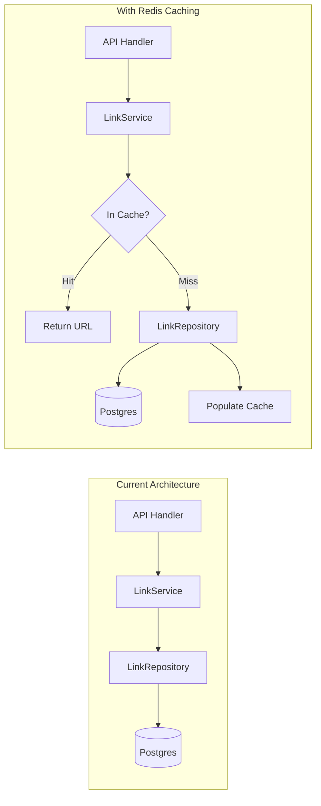

# System Architecture & Design Decisions

This document provides an in-depth breakdown of the architecture, engineering decisions, performance strategies, and security considerations implemented in **lnkshort**.

---

## 1. Architectural Philosophy

URL shorteners have an asymmetric traffic profile:

- **Read Heavy**: The redirect path (`GET /{id}`) is called orders of magnitude more frequently than write paths (`POST /create`, `PUT /{id}`).
- **Strict Latency Budget**: A redirect is a stepping stone for end users. The time spent resolving the short link must be as close to zero as possible (typically sub-20ms at p99).
- **High Concurrency & Fault Tolerance**: Slowdowns or failures in auxiliary features (like click analytics) must never block or degrade the primary redirection path.

To meet these requirements, `lnkshort` adopts a **Layered Clean Architecture** combined with an **asynchronous Tokio/Axum runtime**.



---

## 2. Layered Structure & Separation of Concerns

### 2.1 API & Presentation Layer (`src/api/`)

- **Responsibility**: HTTP routing, request deserialization, header extraction, response formatting, and middleware orchestration.
- **Rules**:
  - Handlers must be thin. No raw SQL queries or complex business logic belong in handlers.
  - Handlers receive typed dependencies via `State(AppState)`.
  - Errors are returned as `AppError`, which Axum automatically converts to HTTP responses via `IntoResponse`.

### 2.2 Service Layer (`src/services/`)

- **Responsibility**: Pure application logic, domain invariants, retry loops, security algorithms, and business metric emissions.
- **Key Services**:
  - `LinkService`: Validates URLs, generates short IDs, manages collision retries, and coordinates persistence.
  - `StatsService`: Bounded analytics ingestion and aggregated metrics calculation.
  - `AuthService`: Constant-time API key validation and authentication enforcement.
- **Rules**: Services do not know about Axum HTTP requests, query params, or status codes. They operate strictly with Rust data structures and domain errors.

### 2.3 Repository Layer (`src/repository/`)

- **Responsibility**: Direct data persistence and query execution using `sqlx`.
- **Key Repositories**:
  - `LinkRepository`: CRUD queries for the `links` table.
  - `StatsRepository`: Ingestion and aggregated grouping queries for `lnkstats`.
  - `SettingsRepository`: Retrieval of authentication credentials and configuration.
- **Rules**: Repositories contain all SQL queries. If the underlying database changes or caching is added, only this layer is modified.

### 2.4 Domain Models & DTOs (`src/models/`)

- Strict separation between database models and incoming/outgoing JSON DTOs:
  - `Link`: Internal database model and JSON response entity.
  - `LinkTarget`: Inbound JSON payload containing target destination.
  - `LinkStats`: Aggregated statistics response DTO.
  - `CreateStat`: Data structure for click events.
  - `Setting`: Internal authentication credentials record.

---

## 3. Deep Dive into Key Design Decisions

### 3.1 Random Entropy vs Sequential IDs

| Approach | Pros | Cons | Decision |
| --- | --- | --- | --- |
| **Auto-Increment Base62** | Zero collisions, compact | Predictable, susceptible to enumeration & competitor scraping | ❌ Rejected |
| **UUIDv4** | Universally unique | Too long (36 chars) for short links | ❌ Rejected |
| **Cryptographic Random 64-bit Base64** | Compact (11 chars), non-enumerable, collision resistant | Requires collision handling | ✅ **Adopted** |

#### Implementation Rationale

- Using `rand::random_range(0..u64::MAX)` encoded via `URL_SAFE_NO_PAD` yields an 11-character URL-safe string.
- With 64 bits of entropy ($2^{64} \approx 1.84 \times 10^{19}$ combinations), collision probability remains negligible even with millions of entries.
- If a collision does occur, the `create_link` loop catches PostgreSQL `UniqueViolation` (`23505`), logs a warning, and retries up to `LINK_MAX_RETRIES` (default: 3). If retries exhaust, `exhausting_unique_entries` counter increments.

### 3.2 Non-Blocking Analytics Architecture

In high-traffic systems, writing an analytics record synchronously on every redirect can bottleneck database write IOPS and degrade redirect latency.

#### Current Design

1. Destination lookup runs first with a tight timeout (`QUERY_TIMEOUT_MS`, default: 300ms).
2. The click event is executed with timeout protection. If the analytics write times out or fails, the error is logged, but the client receives their `307 Temporary Redirect` without delay.

#### Expansion Roadmap for High Scale (>10,000 req/sec)

- Replace synchronous repository calls with an in-memory Tokio `mpsc::channel`.
- A background worker task flushes buffered clicks in batches (e.g. `COPY` or multi-value `INSERT INTO lnkstats`) every 500ms or 1,000 items.
- Alternatively, stream events to an external message broker (Kafka, AWS Kinesis) or columnar store (ClickHouse).

### 3.3 Side-Channel Attack Mitigation (Constant-Time Auth)

Traditional string equality (`a == b`) terminates comparison on the first mismatched byte. An attacker measuring request latencies with high precision can incrementally deduce an API key.

`AuthService::constant_time_compare`:

```rust
fn constant_time_compare(a: &[u8], b: &[u8]) -> bool {
    if a.len() != b.len() {
        return false;
    }
    a.iter().zip(b.iter()).fold(0, |acc, (x, y)| acc | (x ^ y)) == 0
}
```

All bytes are XOR-evaluated regardless of where the first difference appears, preventing timing leaks.

### 3.4 Open Redirect & XSS Defense

Allowing arbitrary schemes in short links opens users to Cross-Site Scripting (XSS) via `javascript:alert(1)` or phishing redirects.

`LinkService::validate_url`:

- Validates URL syntax using the standard `url` crate.
- Restricts allowed schemes strictly to `http` and `https`.
- Malformed or unsupported schemes return `409 Conflict` (`url malformed`), preventing exploit delivery.

### 3.5 Edge Caching Strategy

The redirect handler attaches:

```http
Cache-Control: public, max-age=300, s-maxage=300, state-while-revalidate=300, stale-if-error=300
```

- **`max-age=300`**: Browser caches the redirect for 5 minutes.
- **`s-maxage=300`**: Shared caches (CDN edge nodes like Cloudflare or CloudFront) cache the response.
- **`stale-while-revalidate`**: Downstream caches serve stale redirects instantly while fetching updates asynchronously.
- **Impact**: Under viral traffic, 95%+ of redirect requests can be served directly from CDN edge caches without touching the application server or PostgreSQL.

---

## 4. Database Schema & Indexing Analysis

### 4.1 Schema Definitions

```sql
-- Links master table
CREATE TABLE IF NOT EXISTS links (
    id TEXT NOT NULL PRIMARY KEY, 
    target_url TEXT NOT NULL
);

-- Analytics log table
CREATE TABLE IF NOT EXISTS lnkstats (
    id SERIAL PRIMARY KEY,
    link_id TEXT NOT NULL,
    referer TEXT,
    user_agent TEXT,
    CONSTRAINT fk_links FOREIGN KEY (link_id) REFERENCES links (id)
);

CREATE INDEX idx_link_statistics_link_id ON lnkstats USING btree (link_id);

-- System settings table
CREATE TABLE IF NOT EXISTS settings (
    id TEXT DEFAULT 'DEFAULT_SETTINGS' NOT NULL PRIMARY KEY,
    encrypted_global_api_key TEXT NOT NULL
);
```

### 4.2 Indexing Rationale

- **`links.id` Primary Key**: Implemented as a B-Tree index by default, providing $O(\log N)$ lookup time for redirects.
- **`idx_link_statistics_link_id`**: In `get_stats`, queries aggregate via:
  
  ```sql
  SELECT count(*) as amount, referer, user_agent 
  FROM lnkstats 
  WHERE link_id = $1 
  GROUP BY link_id, referer, user_agent;
  ```

  The B-tree index on `link_id` allows Postgres to perform an index scan rather than a sequential table scan across all historical clicks.

---

## 5. Extensibility & Expansion Patterns

The codebase is engineered to make future features trivial to add:



### 1. Adding In-Memory / Redis Caching

Implement a caching layer in `services/link_service.rs`:

- On `get_link`: Check Redis key `link:{id}`. On hit, return immediately. On miss, query `LinkRepository` and set key with a 1-hour TTL.
- On `update_link`: Invalidate or update `link:{id}` in Redis.

### 2. User Accounts & Multi-Tenancy

1. Add `user_id UUID` to `links` table.
2. Extend `src/models/link.rs` with `user_id`.
3. Add JWT / Session authentication middleware in `src/api/middleware/auth.rs`.
4. Update `LinkRepository::create` and `LinkRepository::find_by_user` to scope queries by `user_id`.

### 3. Distributed Rate Limiting

Add `tower` middleware (such as `tower_governor`) in `src/api/mod.rs` to rate limit by client IP, protecting the service from brute-force URL generation or denial-of-service attempts.
